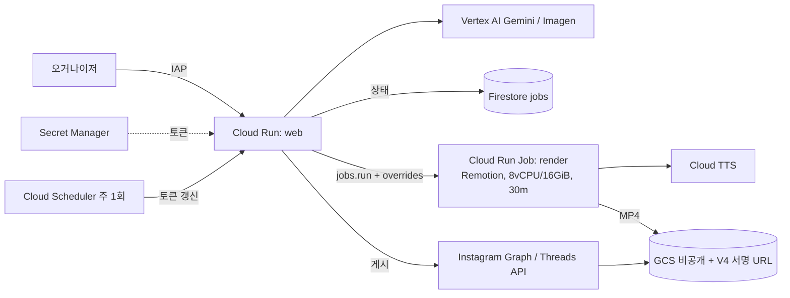

# SPEC — GDG BrandKit & Reels Studio (기술 명세)

> v1.0 · 2026-10-18 · 개발 제한 시간 **90분** · Antigravity 공통 컨텍스트 문서
> 제품 범위는 [PRD.md](./PRD.md), 작업 단위는 [BACKLOG.md](./BACKLOG.md)를 따릅니다. 이 문서와 PRD가 충돌하면 이 문서가 우선합니다.

---

## 1. 한 줄 요약

오거나이저가 **웹 폼에 기획서를 입력·수정**하면 Gemini가 홍보 문구를 생성하고, 코드 템플릿이 썸네일·카드뉴스·릴스 프리뷰·SNS 문구를 만듭니다. 각 에셋은 **추가 프롬프트로 개별 수정**할 수 있습니다.

## 2. 핵심 원칙

1. **글자와 로고는 코드가 그립니다.** 이미지·영상 생성 AI에게 텍스트를 그리게 하지 않습니다.
2. **데이터는 두 층입니다.** 오거나이저가 입력한 `EventPlan`(사실)과 Gemini가 만든 `Generated`(문구·구성)를 분리합니다. Gemini는 `EventPlan`의 사실(일시·장소·연사)을 바꿀 수 없습니다.
3. **색은 토큰 7개만 씁니다.** 템플릿·컴포넌트에 hex 값을 직접 쓰지 않습니다.
4. **90분 범위 밖은 만들지 않습니다.** 9절의 "해커톤 이후" 항목은 코드 스텁도 만들지 않습니다.

## 3. 디자인 토큰 (고정)

```ts
// lib/tokens.ts — 저장소에서 hex 값이 등장하는 유일한 파일
export const color = {
  blue:   '#4285F4',
  red:    '#EA4335',
  yellow: '#FBBC05',
  green:  '#34A853',
  ink:    '#202124', // Dark Grey: 본문·제목
  paper:  '#F8F9FA', // Light Grey: 내부 슬라이드 배경
  white:  '#FFFFFF',
} as const;
export type BrandColor = 'blue' | 'red' | 'yellow' | 'green';
export const brandCycle: BrandColor[] = ['blue', 'red', 'yellow', 'green'];
```

- Yellow는 **`#FBBC05`** 입니다. 원본 기획서의 `#FBBC04`는 쓰지 않습니다.
- 회색 보조 텍스트가 필요하면 `ink`에 투명도(`opacity: 0.6`)를 줍니다. 새 색을 만들지 않습니다.
- 그라데이션은 토큰 색끼리만 섞습니다(예: I/O 테마의 강조 단어 `blue → red → yellow`).
- 폰트: **Pretendard**(OFL, 한글·영문). Satori는 WOFF2를 읽지 못하므로 `Pretendard-Bold.otf`, `Pretendard-Regular.otf`를 `assets/fonts/`에 둡니다. Google Sans는 라이선스 문제로 쓰지 않습니다.

### 테마 프리셋

| 프리셋 | 표지·키비주얼 | 내부 슬라이드 | 참고 게시물 |
| --- | --- | --- | --- |
| `BUILD_WITH_AI` | `paper` 배경 + 4색 블롭·도형, 굵은 4색 입체 타이포 | `paper` 배경 + 가장자리 4색 블롭 + 흰 패널 | 2026 Build with AI Hands-on Campus |
| `IO_EXTENDED` | `ink`(검정) 배경, 흰 굵은 타이포, 핵심 단어 1개 그라데이션, 좌측 세로 컬러 바 | 같은 레이아웃, 다크 배경 | 2026 I/O Extended Hack the Beat |
| `DEVFEST` | `paper` 배경, 큰 한글 타이포 + 굵은 기하 도형, 띠 라벨 | `paper` 배경 + 흰 패널 | 2025 DevFest 모각코 |

## 4. 프로젝트 구조 (단일 Next.js 앱)

```
gdg-brandkit-studio/
├─ AGENTS.md                       # Antigravity 작업 규칙
├─ docs/  PRD.md  SPEC.md  BACKLOG.md
├─ app/
│  ├─ page.tsx                     # 좌: 기획서 폼 / 우: 에셋 탭 4개
│  ├─ api/generate/route.ts        # EventPlan → Generated 전체 생성
│  ├─ api/refine/route.ts          # 에셋 1개를 추가 프롬프트로 수정
│  └─ api/render/[kind]/route.tsx  # next/og ImageResponse → PNG (thumbnail | card)
├─ components/
│  ├─ PlanForm.tsx                 # 기획서 입력·수정 폼
│  ├─ AssetPanel.tsx               # 프리뷰 + 프롬프트 입력창 + 되돌리기 (모든 에셋 공용)
│  └─ templates/                   # Satori용 JSX: Thumbnail, CardCover, CardIntro, ...
├─ remotion/
│  ├─ Reel.tsx                     # <Series>로 scenes 이어 붙이기
│  └─ scenes/                      # KineticStompText, BentoGridShowcase (MVP 2종)
├─ lib/  tokens.ts  schema.ts  gemini.ts  storage.ts
├─ assets/fonts/  public/logo/gdg-lockup.svg
├─ fixtures/sample-plan.json  fixtures/sample-generated.json
├─ Dockerfile
└─ .env.local                      # GEMINI_API_KEY (커밋 금지)
```

- DB를 두지 않습니다. 기획서와 생성 결과는 브라우저 `localStorage`에 저장합니다(`lib/storage.ts`).
- 모노레포, 상태 관리 라이브러리, UI 컴포넌트 라이브러리를 넣지 않습니다. 스타일은 Tailwind만 씁니다.

## 5. 데이터 모델 (`lib/schema.ts`, zod)

### 5.1 `EventPlan` — 웹 폼으로 입력·수정하는 기획서

| 필드 | 타입 | 폼 입력 방식 | 예시 |
| --- | --- | --- | --- |
| `theme` | `'BUILD_WITH_AI' \| 'IO_EXTENDED' \| 'DEVFEST'` | select | `BUILD_WITH_AI` |
| `year` | string | text | `2026` |
| `title` | string | text | `Build with AI Hands-on Campus` |
| `hostName` | string | text (기본값) | `GDG Campus Korea` |
| `hook` | string | text | `AI로 어디까지 만들 수 있을까?` |
| `description` | string | textarea | 행사 소개 2~3줄 |
| `date` | string (`YYYY-MM-DD`) | `<input type="date">` | `2026-05-09` |
| `startTime` / `endTime` | string (`HH:mm`) | `<input type="time">` | `12:30` / `17:30` |
| `venue` | string | text | `서강대학교 정하상관` |
| `capacity` | number? | number | `200` |
| `programSummary` | string | text | `총 9개의 Hands-on과 3개의 Session` |
| `targetAudience` | string | textarea | `대학생, 취업 준비생, 주니어 개발자` |
| `perks` | string[] | 태그 입력 | `["굿즈", "간식"]` |
| `registration` | `{ platform: 'EVENTUS' \| 'TICKETTACO' \| 'OTHER', url: string, deadline?: string }` | select + url + date | |
| `schedule` | `{ start, end, title, note?, highlight: boolean }[]` | 행 추가·삭제 표 | `13:30, 14:30, Hands-on Time 1, Hands-on Track 1,2,3 / Session Track 4, true` |
| `speakers` | `{ name, affiliation, sessionTitle, summary, photoUrl?, kind: 'HANDS_ON' \| 'SESSION' }[]` | 행 추가·삭제 카드 | |
| `specialEvents` | `{ title, desc }[]` | 행 추가·삭제 | |
| `sponsors` | string[] | 태그 입력 | |

- 폼은 이 스키마 하나에서 필드를 그립니다. 필드를 추가하면 스키마부터 고칩니다.
- 필수 필드: `theme`, `year`, `title`, `date`, `startTime`, `venue`. 나머지는 비어 있어도 생성이 동작해야 합니다.
- 연사 사진은 URL 입력 또는 파일 선택(`FileReader`로 data URL 변환)만 지원합니다. 업로드 서버는 없습니다.
- 폼 값은 입력할 때마다 `localStorage`에 저장되어, 새로고침해도 이어서 수정할 수 있습니다.

### 5.2 `Generated` — Gemini가 만드는 홍보 문구·구성

```ts
Generated = {
  thumbnail: { headline: string; subline: string; style: AssetStyle },
  cards: CardSlide[],             // 6~10장
  reel: { scenes: ReelScene[] },  // 합계 15~20초
  sns: { instagramCaption: string; threadsMain: string; threadsReply: string },
}

AssetStyle = { accent: BrandColor; layout: 'A' | 'B'; emphasis: 'calm' | 'bold' }

CardSlide =
  | { type: 'COVER';    headline: string; style: AssetStyle }
  | { type: 'INTRO';    hookTitle: string; hookBody: string;
                        sections: { label: string; body: string }[]; style: AssetStyle }  // 라벨 예: 행사 구성, 이런 사람들에게 추천해요, 진행 장소 및 시간
  | { type: 'TIMETABLE'; title: string; style: AssetStyle }          // 행 데이터는 EventPlan.schedule에서 읽음
  | { type: 'SPEAKERS'; title: string; kind: 'HANDS_ON' | 'SESSION';
                        speakerIndexes: number[]; style: AssetStyle } // 한 장에 최대 3명
  | { type: 'SPECIAL_EVENT'; title: string; style: AssetStyle }
  | { type: 'CTA';      headline: string; body: string; style: AssetStyle }
  | { type: 'D_DAY';    daysLeft: number; style: AssetStyle }

ReelScene = { component: 'KineticStompText' | 'BentoGridShowcase';
              durationSec: number; overlayText: string; highlightWords: string[] }
```

- **사실은 참조만 합니다.** TIMETABLE·SPEAKERS 슬라이드는 일시·연사 정보를 `EventPlan`에서 직접 읽고, Gemini는 제목과 순서만 정합니다. 그래서 Gemini가 연사 이름이나 시간을 틀리게 쓸 수 없습니다.
- `style`은 enum만 허용합니다. "더 빨갛게" 같은 프롬프트는 `accent: 'red'`로 바뀌고, 임의의 hex 값은 스키마가 거부합니다.
- Gemini에는 `z.toJSONSchema(GeneratedSchema)`를 `responseJsonSchema`로 넘기고, 응답은 반드시 `parse`합니다. `.refine`, `.transform`은 JSON Schema로 옮겨지지 않으므로 스키마에 쓰지 않습니다.

## 6. 산출물 규격

### 6.1 티켓팅 썸네일

| 플랫폼 | 크기 | 구성 |
| --- | --- | --- |
| 이벤터스 | 1280x720 | 좌측: 연도 + 타이틀(2줄) + hostName, 일시·장소 배지 / 우측: 테마 키비주얼 |
| 티켓타코 | 1200x630 | 같은 템플릿, 크기만 변경 |

### 6.2 인스타 카드뉴스 — GDG Campus Korea 포맷

크기 **1080x1350**(4:5). 참고: [@gdg.campuskorea](https://www.instagram.com/gdg.campuskorea/)의 2026 Build with AI Hands-on Campus 게시물(7장).

**공통 프레임 (COVER, D_DAY 제외 모든 슬라이드)**
- 배경 `paper`, 네 가장자리에 4색 블롭이 살짝 잘려 보이도록 배치합니다.
- 가운데 큰 흰색 라운드 패널(radius 32px) 안에 콘텐츠를 넣습니다.
- 패널 좌상단: GDG 로고 락업("Google Developer Groups / Campus Korea").
- 패널 상단 가운데: 작은 타이틀 블록 3줄(`year` / `title` / `hostName`).
- 섹션 제목 강조는 두 가지만 씁니다: ① **노란 알약 라벨**(`yellow` 배경, `ink` 글자, 예: "Time Table", "행사 구성"), ② **단어 하이라이트**(제목 첫 단어 밑에 `accent` 색 형광펜 띠, 예: "**Hands-on** Speakers").

| 타입 | 레이아웃 |
| --- | --- |
| `COVER` | 전면 키비주얼. 상단 가운데 `year` / `title`(굵게 2줄) / `hostName`. 테마별 큰 타이포 그래픽 |
| `INTRO` | 상단 훅 박스(테두리 라운드 박스: 굵은 `hookTitle` + 2줄 `hookBody`) → 노란 알약 라벨 섹션 3개 |
| `TIMETABLE` | 노란 알약 "Time Table" → 테두리 라운드 표. 행 = 시간(2줄) │ 제목 │ 비고. `highlight` 행은 시간·제목이 `blue`, 구분선도 `blue` |
| `SPEAKERS` | 단어 하이라이트 제목 → 연사 3명 세로 배치. 원형 사진(좌) + 이름(굵게) + 소속(작게, 60% 투명도) + 구분선 + 세션 제목(굵게) + 요약 2~3줄 |
| `SPECIAL_EVENT` | 노란 알약 라벨 → 이벤트 카드 목록 |
| `CTA` | 신청 방법, 마감일, "프로필 링크에서 신청" 안내 |
| `D_DAY` | 표지 테마 그대로 + 화면 중앙 초대형 "D-5" |

**슬라이드 구성 규칙**
- 기본 순서: COVER → INTRO → TIMETABLE → SPEAKERS(HANDS_ON) → SPEAKERS(SESSION) → (SPECIAL_EVENT) → CTA.
- 연사가 3명을 넘으면 SPEAKERS 슬라이드를 3명씩 나눕니다.
- 전체 6~10장. 10장을 넘으면 SPECIAL_EVENT부터 뺍니다.

**인스타 캡션 구조** (참고 게시물과 같은 순서)
```
{hook 질문}

{문제 제기 2줄}
{행사 소개 2줄}

📌 상세 타임테이블과 최신 연사자 정보는 프로필 링크에서 확인해주세요

🔥 프로그램 구성
- ...

🛠️ 행사 특징
- ...

#GDG #GDGCampusKorea #...
```

### 6.3 릴스 프리뷰

- 1080x1920, **60fps**, 15~20초. `@remotion/player`로 브라우저에서만 재생합니다.
- MVP 컴포넌트 2종: `KineticStompText`(단어가 `spring()`으로 튕기며 등장, `highlightWords`는 `brandCycle` 색), `BentoGridShowcase`(일시·장소·트랙·혜택 칸이 차례로 조립된 뒤 줌아웃).
- 목록에 없는 컴포넌트 이름이 오면 `KineticStompText`로 대체합니다.
- 애니메이션은 `useCurrentFrame` + `spring`/`interpolate`로만 만듭니다. `Math.random`, `Date`는 쓰지 않습니다.
- 프레임 수 = `Math.round(durationSec * 60)`.

### 6.4 SNS 문구

- 인스타 캡션 ≤ 2,200자, 해시태그 ≤ 30개. 스레드 본문 ≤ 500자.
- 스레드 신청 링크는 본문이 아닌 `threadsReply`(대댓글)에 넣습니다.

## 7. Gemini 연동

### 7.1 모델과 인증

- SDK: `@google/genai`. 해커톤에서는 **AI Studio API 키**(`GEMINI_API_KEY`)를 씁니다. Vertex AI 서비스 계정 설정 시간을 아끼기 위해서입니다.
- 모델: `GEMINI_MODEL` 환경 변수로 지정하며 기본값은 `gemini-2.5-flash`입니다. 짧은 폼 입력을 JSON으로 바꾸는 작업이라 응답 속도가 중요하고, 고성능 추론 모델은 필요하지 않습니다. 당일 사용 가능한 모델명을 확인해 바꿀 수 있습니다.
- 키는 서버 라우트에서만 읽습니다. 클라이언트 컴포넌트에서 `process.env.GEMINI_API_KEY`를 참조하지 않습니다.

### 7.2 `POST /api/generate`

- 입력: `EventPlan` → 출력: `Generated`.
- 프롬프트 규칙: 한국어, GDG 커뮤니티 톤(친근하지만 과장 없이), `EventPlan`에 없는 사실은 만들지 않음, 카드 구성은 6.2 규칙을 따름.
- 스키마 검증에 실패하면 zod 오류 메시지를 붙여 **한 번만** 다시 요청합니다. 두 번째도 실패하면 사용자에게 오류를 표시합니다.

### 7.3 `POST /api/refine` — 에셋별 추가 프롬프트 수정

모든 에셋 패널 아래에 프롬프트 입력창이 있습니다. 오거나이저가 "제목을 더 짧게", "노란색 위주로", "연사 순서를 바꿔줘" 같은 지시를 입력하면 **그 에셋만** 바뀝니다.

```ts
// 요청
{ target: 'thumbnail' | `cards.${number}` | 'reel' | 'sns',
  instruction: string,           // 오거나이저가 입력한 추가 프롬프트
  current: unknown,              // 현재 그 에셋의 Generated 조각
  plan: EventPlan }              // 사실 참조용 (수정 불가)
// 응답: 같은 타입의 Generated 조각
```

- 서버는 `target`에 맞는 하위 스키마(`ThumbnailSchema`, `CardSlideSchema`, `ReelSchema`, `SnsSchema`)를 골라 `responseJsonSchema`로 넘깁니다. 다른 에셋은 요청에 넣지 않으므로 바뀔 수 없습니다.
- 지시가 사실 변경("날짜를 바꿔줘")이면 수정하지 않고 "기획서 폼에서 수정해 주세요"라는 안내를 돌려줍니다. 사실은 폼에서만 바꿉니다.
- 색 지시는 `style.accent` enum 안에서만 반영됩니다.
- 클라이언트는 에셋마다 **최근 5개 버전**을 보관하고 "되돌리기" 버튼을 제공합니다.
- 기획서 폼을 수정한 뒤 "전체 다시 생성"을 누르면 refine 결과가 덮어써진다는 확인 창을 띄웁니다. 폼의 사실 필드만 바뀐 경우에는 다시 생성하지 않아도 템플릿에 즉시 반영됩니다(5.2의 참조 구조 덕분입니다).

## 8. 배포 (Cloud Run 서비스 1개)

```bash
PROJECT=<개인 GCP 프로젝트>; REGION=asia-northeast3
gcloud config set project $PROJECT
gcloud services enable run.googleapis.com cloudbuild.googleapis.com \
  artifactregistry.googleapis.com secretmanager.googleapis.com
printf %s "$GEMINI_API_KEY" | gcloud secrets create gemini-api-key --data-file=-
# Cloud Run 런타임 서비스 계정에 roles/secretmanager.secretAccessor 부여 후:
gcloud run deploy brandkit --source . --region $REGION \
  --cpu 1 --memory 1Gi --min-instances 0 --max-instances 2 \
  --allow-unauthenticated \
  --set-env-vars GEMINI_MODEL=gemini-2.5-flash \
  --set-secrets GEMINI_API_KEY=gemini-api-key:latest
```

- 해커톤 범위에는 서버 영상 렌더링이 없으므로 1 vCPU / 1GiB로 충분합니다.
- `Dockerfile`: `node:22-bookworm-slim`, Next.js `output: 'standalone'`, `PORT` 환경 변수를 따릅니다. 폰트는 `assets/fonts/`에서 `fs.readFile`로 읽으므로 이미지에 포함합니다.
- PNG 렌더 라우트는 `export const runtime = 'nodejs'`로 둡니다(Edge 런타임은 폰트 번들 크기 제한에 걸립니다).
- 회사 조직 프로젝트는 `--allow-unauthenticated`가 조직 정책으로 막힐 수 있으니 개인 프로젝트를 씁니다.
- 예산 알림: `gcloud billing budgets create --billing-account=$BA --display-name=brandkit --budget-amount=20USD --threshold-rule=percent=0.5 --threshold-rule=percent=1.0`

## 9. 범위 경계

| 해커톤 90분 (만듦) | 해커톤 이후 (만들지 않음, 스텁도 금지) |
| --- | --- |
| 기획서 웹 폼 + localStorage 저장 | 다중 사용자, 로그인, DB |
| Gemini 전체 생성 + 에셋별 refine | Imagen 배경 생성 |
| 썸네일 2종, 카드뉴스 6~10장 PNG | X배너·현수막 인쇄용 벡터 PDF |
| 릴스 Player 프리뷰 (컴포넌트 2종) | 컴포넌트 5종 전체, 효과음, TTS, BGM 더킹 |
| SNS 문구 + 복사 버튼 | MP4 서버 렌더링 (Cloud Run Jobs) |
| Cloud Run 서비스 1개 배포 | 인스타그램·스레드 자동 게시 |

## 10. 해커톤 타임라인 (90분)

| 분 | 작업 | 백로그 |
| --- | --- | --- |
| 0–10 | `create-next-app`, tokens, schema, fixtures, 폰트 | BK-01 |
| 10–25 | 기획서 웹 폼 + localStorage | BK-02 |
| 25–35 | `/api/generate` | BK-03 |
| 35–55 | 썸네일 + 카드뉴스 템플릿 (6.2 포맷) | BK-04, BK-05 |
| 55–70 | 릴스 Player + 컴포넌트 2종 | BK-06 |
| 70–80 | `/api/refine` + AssetPanel 프롬프트 입력·되돌리기, SNS 탭 | BK-07, BK-08 |
| 80–90 | Cloud Run 배포, 리허설 3회 | BK-09 |

**시간이 부족할 때 자르는 순서:** D_DAY 슬라이드 → SPECIAL_EVENT → BentoGridShowcase → 테마 2종(BUILD_WITH_AI만 유지). 기획서 폼, 카드뉴스, refine은 자르지 않습니다.

## 11. 알려진 함정

- **Satori CSS:** flexbox만 지원합니다. 자식이 둘 이상인 `div`에는 반드시 `display: 'flex'`를 줍니다. CSS grid는 동작하지 않으며, 겹치는 요소는 `position: 'absolute'`로 배치합니다.
- **한글 폰트:** 폰트를 넘기지 않으면 한글이 빈 칸으로 나옵니다. OTF/TTF만 됩니다.
- **긴 텍스트:** Satori는 글자 크기를 자동으로 줄이지 않습니다. 제목 길이에 따라 글자 크기를 단계별로 고르는 함수 하나(`fitFontSize(text, maxChars)`)를 템플릿에서 공용으로 씁니다.
- **연사 사진:** 외부 URL 이미지는 서버에서 가져오므로 실패할 수 있습니다. 실패하면 이니셜 원형으로 대체합니다.
- **Remotion Player:** `next/dynamic`으로 `ssr: false` 로드합니다.

---

## 부록 A. 해커톤 이후 목표 아키텍처 (참고용, 지금 구현하지 않음)



| 주제 | 결정 |
| --- | --- |
| MP4 렌더 | 직접 만든 Cloud Run Job(`@remotion/renderer`). `@remotion/cloudrun`은 alpha라 쓰지 않음. 같은 입력이면 `jsonHash` 경로 캐시 재사용 |
| BGM 더킹 | FFmpeg 후처리 없이 Remotion `<Audio volume={(f) => ...}>`로 음성 구간 0.251(-12dB), 경계 6프레임 램프 |
| TTS 타임스탬프 | Cloud TTS v1beta1 `enableTimePointing: ['SSML_MARK']` + 어절마다 `<mark>`. SSML 지원 ko-KR 음성(Neural2/WaveNet/Standard)만 가능, Chirp 3 HD는 불가 |
| 인쇄물 | 300dpi 래스터 금지(X배너 7087x21260px). Satori SVG → 벡터 PDF, 재단 여백 3mm, CMYK 색 차이 안내 |
| 인스타 게시 | 컨테이너 생성 → `status_code=FINISHED` 폴링(5초, 최대 5분) → `media_publish`. 이미지는 JPEG만 가능. 단계별 ID 저장 + 캡션 마커로 중복 게시 방지 |
| 스레드 게시 | 본문 게시 → 상태 폴링 → `reply_to_id`로 신청 링크 대댓글. 고정 대기(1초) 금지 |
| 토큰 | long-lived 토큰 약 60일. Cloud Scheduler가 주 1회 갱신해 Secret Manager 새 버전으로 저장 |
| 사전 준비 | Meta 앱 심사(`instagram_content_publish`, `threads_content_publish`), IG 비즈니스 계정, Remotion 라이선스(GDG가 무료 대상인지 서면 확인) |
| 비용 | 월 약 $5~15 추정. min-instances 0, GCS lifecycle 14/30일, 예산 알림 $30 |
